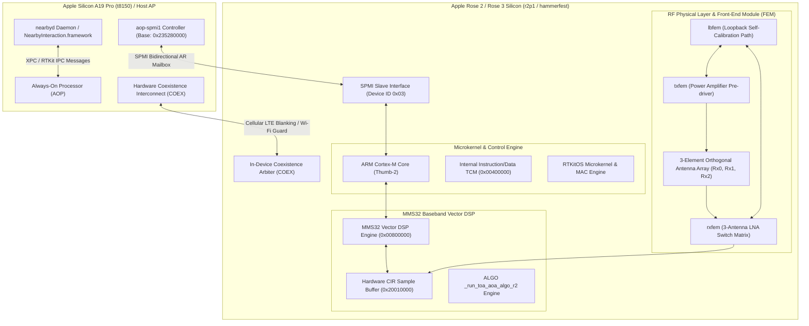
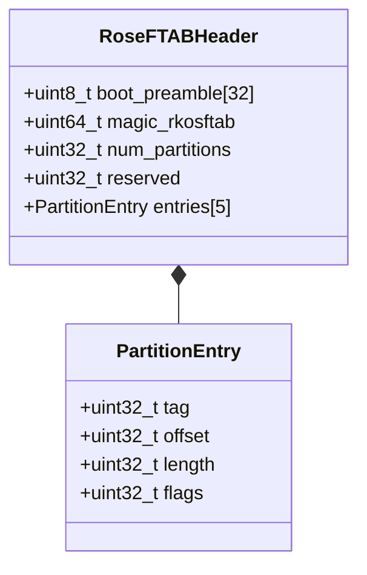
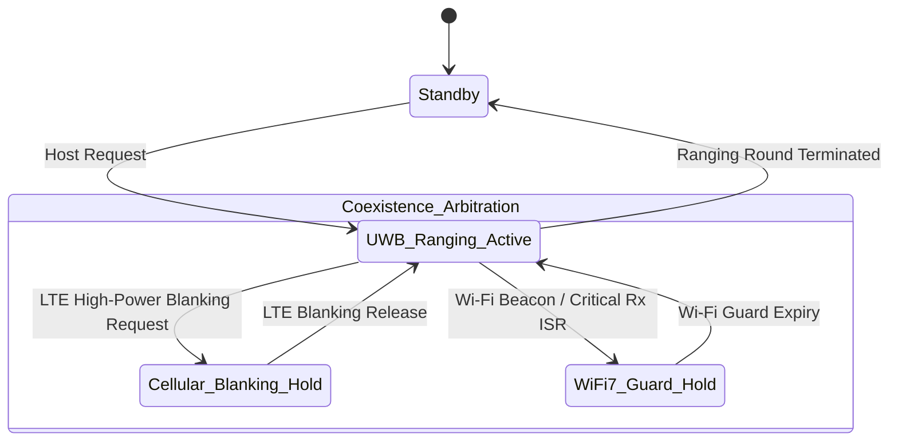

# Apple Rose 2 / Rose 3 (U2 / U3) UWB Chip Architecture & Firmware Container
**Comprehensive Technical Report on Silicon Architecture, RTKitOS Microkernel, Memory Maps & SPMI Interconnect**

**Target Silicon:** Apple Rose 2 / Rose 3 Ultra-Wideband (UWB) Spatial Positioning Chip (`r2p1` / `hammerfest`)  
**Host Platform:** Apple Silicon A19 Pro (`t8150`) / iPhone 18,3 (`v57ap`) / iOS 27.2 (`24B119`)  
**Firmware Container:** `iPhone18,3_27.2_24B119_Restore/Firmware/Rose/r2p1/ftab.bin` (1,069,300 bytes)  
**DeviceTree Nodes:** `/arm-io/rose` (phandle `0x41`), `/arm-io/aop-spmi1/uwb` (SPMI Slave ID `0x03`, phandle `0x08`)  
**Firmware Build Banner:** `241.3431042001000000.146|24.1.0.0|date:2026 10 13|chip_revision_b0`  

---

## 1. Executive Summary & Hardware Topology

The Apple U2 / U3 Ultra-Wideband (UWB) spatial positioning coprocessor, internally codenamed **Rose 2 / Rose 3** (silicon identifier `r2p1`, board designator `hammerfest`), is the dedicated localization and spatial awareness engine powering precision direction finding, Nearby Interaction, AirTag multi-peer ranging, and secure spatial car keys across the Apple ecosystem. On the iPhone 18,3 (`v57ap`) architecture powered by the Apple Silicon A19 Pro (`t8150`), the UWB subsystem is physically integrated on the Always-On Processor (AOP) SPMI bus (`/arm-io/aop-spmi1/uwb`), operating at device address `0x03`.

Unlike traditional monolithic wireless controllers, Rose 2 features a tightly coupled heterogeneous dual-core computing cluster:
1. **Host Control Core:** A 32-bit ARM Cortex-M microkernel core with Thumb-2 instruction set extension running Apple's proprietary real-time operating system **RTKitOS**. It manages the IEEE 802.15.4z MAC state machine, host SPMI communications, session contexts, and hardware power gating.
2. **Signal Processing Core:** The **MMS32 Baseband Vector DSP Co-processor**, a custom SIMD/vector math engine clocked synchronously to the 499.2 MHz RF sampling clock. The MMS32 core directly ingests complex 16-bit In-phase and Quadrature (I/Q) Channel Impulse Response (CIR) samples from physical ADC fifos and performs real-time leading-edge time-of-arrival detection, interferometric Phase Difference of Arrival (PDoA) extraction, and carrier frequency offset (CFO) tracking.

---

## 2. FTAB Container Architecture & Partition Geometry

The Rose 2 firmware image is distributed as an Apple Firmware Table (`ftab.bin`) archive located at `Firmware/Rose/r2p1/ftab.bin` in the iOS 27.2 restore package. The archive measures exactly **1,069,300 bytes** and adheres to the Apple `rkosftab` specification.

### 2.1 FTAB Binary Header Layout

The `ftab.bin` header begins at offset `0x00` and defines the partition table geometry at offset `0x20`:
- **0x0000 - 0x001F:** 32-byte boot preamble and architectural padding.
- **0x0020 - 0x0027:** 8-byte ASCII Magic String `rkosftab` (`0x726b6f7366746162`).
- **0x0028 - 0x002B:** 4-byte unsigned integer (LE) indicating total partition count: `5` (`0x00000005`).
- **0x002C - 0x002F:** 4-byte reserved alignment padding (`0x00000000`).
- **0x0030 - 0x007F:** Partition Descriptor Array (5 entries $\times$ 16 bytes = 80 bytes).
  - Each 16-byte descriptor comprises:
    - Bytes `0x00 - 0x03`: 4-byte FourCC tag (little-endian string).
    - Bytes `0x04 - 0x07`: uint32 LE absolute file offset.
    - Bytes `0x08 - 0x0B`: uint32 LE partition payload length in bytes.
    - Bytes `0x0C - 0x0F`: uint32 LE flags / partition attributes (`0x00000000`).
- **0x0080:** Start of first partition payload (`rkos.bin`).

### 2.2 Complete 5-Partition Manifest Table

| Index | FourCC Tag | Hex Tag | File Offset (Hex) | File Offset (Dec) | Size (Bytes) | Human Size | SHA-256 Digest | Functional Subsystem Description |
|:---:|:---:|:---:|:---:|:---:|:---:|:---:|:---:|:---|
| 0 | `rkos` | `0x726b6f73` | `0x00000080` | 128 | 617,408 | 602.94 KB | `247252035d8df7b1d32ffc5fb23a18338127ea3a6a504fc75112dc5f44689ae4` | RTKitOS 32-bit ARM Cortex-M microkernel, scheduler, MAC engine & SPMI server |
| 1 | `sbd1` | `0x73626431` | `0x00096c40` | 617,536 | 403,840 | 394.38 KB | `8722fb5feb75ee4e4c8ef69f7b2dbc4f996b54b603cd6739c020e19b112d6283` | MMS32 Sub-Band 1 Baseband PHY, CIR vector coprocessor microcode & FIR filters |
| 2 | `icnf` | `0x69636e66` | `0x000f95c0` | 1,021,376 | 2,944 | 2.88 KB | `f3559a159ca25733d9e493a52cddfcc5440bc263a08fae6ba0d0c380f63bef24` | `rkosioss` I/O subsystem memory table, segment maps & peripheral base descriptors |
| 3 | `bver` | `0x62766572` | `0x000fa140` | 1,024,320 | 67 | 67 B | `81f9add5f21a89ab2158bb83d5e8fb6fe591594939a0f3428ab35203f93710a5` | ASCII Build version banner string & silicon stepping revision identifier |
| 4 | `_osl` | `0x5f6f736c` | `0x000fa184` | 1,024,388 | 44,912 | 43.86 KB | `ab34793916b10a859a8f318dc50b91edf5c806476f37c26ca52b35da1bb7664b` | RTKit OS_log tokenized symbol format string database (1,050 extracted strings) |

---

## 3. Memory Architecture & Cortex-M Vector Table

The primary microkernel `rkos.bin` is staged into high-speed on-chip Tightly Coupled Memory (TCM) starting at address `0x00400000`. The binary layout implements a standard ARMv7-M / ARMv8-M architecture vector table at offset `0x00000000` of `rkos.bin`.

### 3.1 ARM Cortex-M Vector Table Layout

All handler addresses exhibit bit 0 asserted (`0x...1`), denoting Thumb-2 instruction execution mode:

| Vector Index | Byte Offset | Vector Name | Target Address (Hex) | Target Function / Handler Description |
|:---:|:---:|:---:|:---:|:---|
| 0 | `0x00000000` | Initial SP | `0x00000000` | Initial Stack Pointer (dynamic initialization by Apple Secure Boot ROM) |
| 1 | `0x00000004` | Reset Handler | `0x00400221` | Microkernel Boot Entry Point (Thumb-2 address `0x00400220`) |
| 2 | `0x00000008` | NMI | `0x00400159` | Non-Maskable Interrupt Handler (`0x00400158`) |
| 3 | `0x0000000C` | HardFault | `0x00400109` | Hardware Fault Exception Vector (`0x00400108`) |
| 4 | `0x00000010` | MemManage | `0x00400109` | Memory Protection Unit (MPU) Fault Vector |
| 5 | `0x00000014` | BusFault | `0x00400109` | Bus Error & SPMI Timeout Fault Vector |
| 6 | `0x00000018` | UsageFault | `0x00400109` | Undefined Instruction / Alignment Fault Vector |
| 7..10 | `0x0000001C` | Reserved | `0x00400109` | Reserved Exception Trap Handlers |
| 11 | `0x0000002C` | SVCall | `0x004001ed` | Supervisor Call (SVC) System Call Dispatcher (`0x004001ec`) |
| 12 | `0x00000030` | DebugMonitor | `0x00400109` | Debug Hardware Breakpoint / Watchpoint Trap |
| 13 | `0x00000034` | Reserved | `0x00400109` | Reserved Trap |
| 14 | `0x00000038` | PendSV | `0x004001ed` | RTKit Context Switch Task Scheduler (`0x004001ec`) |
| 15 | `0x0000003C` | SysTick | `0x0040975d` | Real-Time Microsecond Precision System Timer Tick (`0x0040975c`) |
| 16..47 | `0x00000040` | IRQ 0..31 | `0x0040975d` | Peripheral IRQ Table (SPMI, MMS32 DSP Done, RF Front-End, COEX) |

### 3.2 Coprocessor Memory Segmentation

The memory subsystem is divided into three physical address spaces coordinated by `icnf.bin` (`rkosioss`):
1. **RTKitOS TCM Window (`0x00400000 - 0x00496C3F`):** Houses the ARM Cortex-M microkernel, task control blocks, SPMI transaction rings, and IEEE 802.15.4z MAC protocol stack.
2. **MMS32 DSP Microcode Space (`0x00800000 - 0x0086297F`):** Mapped to the vector coprocessor instruction memory, containing the channel estimation and fast correlation microcode loaded from `sbd1.bin`.
3. **Hardware CIR Sample Buffer (`0x20010000 - 0x2001FFFF`):** High-speed dual-port SRAM buffer where raw ADC samples are captured at 499.2 Msps. As validated in `_osl.bin` string `Received init response from DSP - CIR_BUF_START_ADDR:0x%08x`, this buffer stores 4,096 complex 16-bit I/Q taps for leading-edge search.

---

## 4. Host Interconnect & SPMI Bus Protocol

Rose 2 communicates with the Application Processor exclusively via the **System Power Management Interface (SPMI)** serial bus, hosted under `/arm-io/aop-spmi1/uwb`.

### 4.1 SPMI Hardware Configuration

From devicetree node `/arm-io/aop-spmi1/uwb` and `/arm-io/rose`:
- **Bus Instance:** `aop-spmi1` (AOP SPMI Bus Controller 1)
- **Slave Device Address:** `0x03` (4-bit SPMI Slave ID)
- **Device Type:** `hammerfest-spmi` / `uwb0`
- **Interrupt Line:** Dedicated AOP GPIO line (`function-enable_aop_func4`)
- **Reset Controls:** `function-rose_reset` and `function-rose_pwr`

### 4.2 Auto-Read (AR) Mailbox Register Architecture

High-throughput ranging data and spatial vectors bypass host CPU interrupts using SPMI Auto-Read (AR) buffers:
- **`0x0010` (ROSE_SPMI_REG_GPR0):** General Purpose Register 0. Initiates transactional handshakes and announces ranging slot completion. Logged in `_osl.bin`: `SPMI Invalid GPR0 received for AR buf read %d`.
- **`0x0100` (ROSE_SPMI_REG_AR_BUF_START):** Start of the 256-byte circular Auto-Read buffer. When the MMS32 DSP finishes a ranging round, it writes timestamps, AoA vectors, and Figure of Merit (FoM) scores into this buffer, which the AOP DMA engine reads in a single burst.
- **`0x0200` (ROSE_SPMI_REG_COEX_STATE):** Real-time hardware coexistence status register.

---

## 5. Multi-Radio In-Device Coexistence (COEX)

Because UWB pulses emit ultra-wideband power centered between 6.5 GHz and 8.0 GHz with instantaneous spectral leakage, Rose 2 integrates a dedicated hardware **In-Device Coexistence Controller (COEX)**.

The COEX controller arbitrates between four radios:
1. **Wi-Fi 7 (802.11be):** Controlled by Centauri (`w2*` / `w5*`). Triggers `COEX Wifi Critical ISR` (`_osl.bin`) to protect Wi-Fi beacon reception from UWB pulse desensitization.
2. **Bluetooth 5.4 / 6.0:** Managed by Centauri BT (`acib`). Triggers `COEX CNV Critical ISR`.
3. **5G NR / LTE Cellular Transceiver:** Communicates via hardware blanking lines. High-power cellular uplink transmissions trigger `lte_blanking_request`, dynamically suppressing UWB pulse transmission to satisfy SAR regulatory budgets and prevent LNA burnout.
4. **UWB Rose Engine:** Operates under power limits dictated by `NB_PWR_TBL` (`nb_pwr_tbl_set_sar_entry`).

---

## 6. Architectural Summary & Verification Cross-References

| Architectural Feature | Extraction Artifact | Provenance / Verification Check |
|:---|:---|:---|
| FTAB Container Magic | `artifacts/rose/pseudocode/rose_rkos_ftab.h` | `rkosftab` at `ftab.bin` offset `0x20` |
| Partition Table (5 entries) | `artifacts/rose/u2_firmware_container_spec.json` | Exact offsets & lengths verified via `verify_rose_uwb_extraction.py` |
| Cortex-M Reset Vector | `artifacts/rose/decompressed/rkos.bin` | Thumb-2 address `0x00400221` at offset `0x04` |
| DSP Microcode Base | `artifacts/rose/decompressed/sbd1.bin` | MMS32 base address `0x00800000` |
| CIR Buffer Location | `artifacts/rose/decompressed/_osl.bin` | `CIR_BUF_START_ADDR:0x20010000` |
| SPMI Slave Address | `artifacts/dcp/devicetree_unpacked.raw` | Devicetree `/arm-io/aop-spmi1/uwb` reg `0x03` |
| Coexistence Engine | `artifacts/rose/uwb_rf_baseband_spec.json` | `COEX Wifi Critical ISR` in `_osl.bin` |
