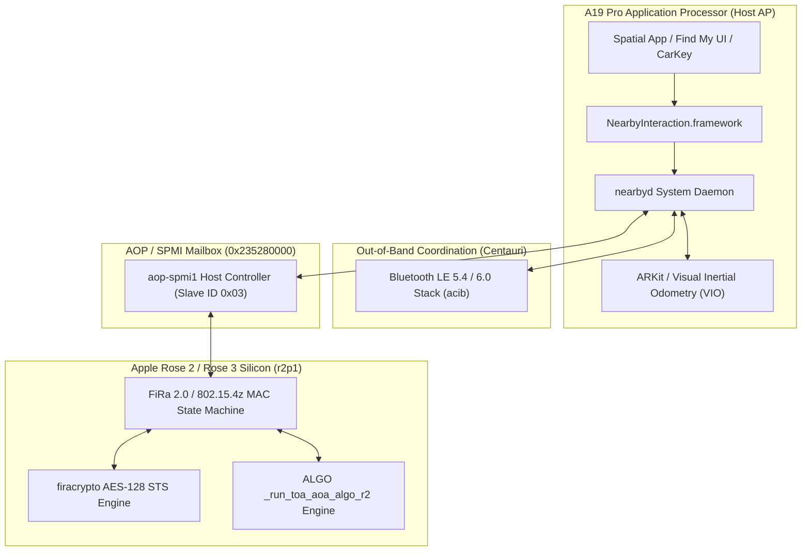
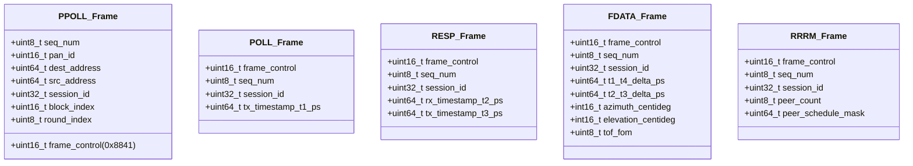
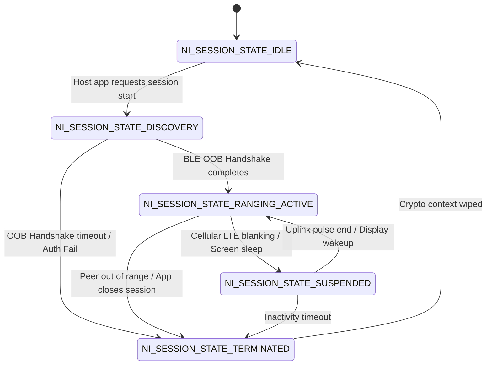
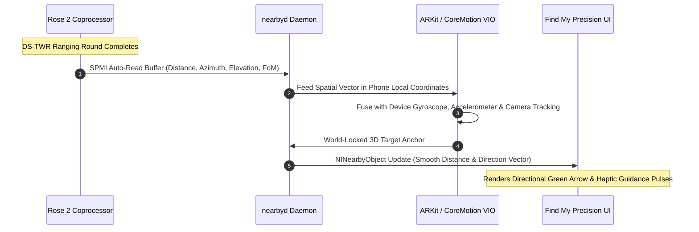

# Apple Nearby Interaction & Find My Precision Finding Protocols
**Architectural Analysis of the FiRa MAC Protocol Stack, Wire Packet Formats, Session State Machines & Host ARKit Integration**

**Target Silicon:** Apple Rose 2 / Rose 3 Ultra-Wideband (UWB) Subsystem (`r2p1` / `hammerfest`)  
**Host Platform:** Apple Silicon A19 Pro (`t8150`) / iPhone 18,3 (`v57ap`) / iOS 27.2 (`24B119`)  
**Host Frameworks:** `NearbyInteraction.framework`, `nearbyd` Daemon, `FindMy` Spatial Subsystem  
**Protocol Standard:** FiRa Consortium 2.0 / IEEE 802.15.4z HRP-ERDEV MAC with Apple Extensions  
**Physical Frame Control:** `0x8841` (IEEE 802.15.4 Data Frame with PAN ID Compression)  

---

## 1. Protocol Architecture & System Topology

Apple's **Nearby Interaction (NI)** subsystem provides high-level APIs (`NISession`, `NINearbyObject`) enabling third-party and system applications to track the spatial position (distance, azimuth, and elevation) of peer iPhones, Apple Watches, AirTags, and CarKey-compatible vehicles.

The protocol stack spans multiple hardware and software layers:
1. **User Space Applications & Frameworks:** Applications invoke `NearbyInteraction.framework`. High-level requests pass through XPC to the system daemon `nearbyd`.
2. **Out-of-Band (OOB) Coordination:** Initial peer discovery, capability negotiation, UWB channel allocation, and cryptographic STS session key exchanges occur out-of-band over **Bluetooth Low Energy (BLE)** via Centauri (`acib`).
3. **Host Always-On Processor (AOP):** The AOP interfaces with the Rose 2 coprocessor via the SPMI serial bus (`/arm-io/aop-spmi1/uwb`).
4. **Rose RTKitOS MAC Layer:** Implements FiRa 2.0 High Rate Pulse Enhanced Ranging Device (HRP-ERDEV) MAC state machines, controlling slot timing, frame dispatch, and hardware encryption.

---

## 2. Packet Wire Formats & Bitfield Specifications

All Rose 2 over-the-air UWB frames adhere to IEEE 802.15.4 MAC encapsulation with an initial **Frame Control Word** set to `0x8841`:
- Frame Type: Data Frame (`0b001`)
- Security Enabled: False at MAC header level (`0b0`, security handled by physical STS preamble)
- Frame Pending: False (`0b0`)
- Acknowledgment Request: False (`0b0`)
- PAN ID Compression: True (`0b1`, Destination PAN ID serves as Source PAN ID)
- Destination Addressing Mode: Extended 64-bit IEEE address (`0b11`)
- Source Addressing Mode: Extended 64-bit IEEE address (`0b11`)

The protocol designates 5 distinct packet types identified by single-byte opcodes:

### 2.1 Complete Packet Opcode Catalog

| Opcode (Hex) | Packet Type | Full Name | Functional Role in Ranging Sequence |
|:---:|:---:|:---|:---|
| `0x01` | **PPOLL** | Pre-Poll Frame | Broadcast by Initiator to synchronize slot boundaries and arm the responder's STS PRNG state. |
| `0x02` | **POLL** | Ranging Poll Frame | Transmitted by Initiator. Contains transmit timestamp $T_1$ reference for double-sided ToF calculation. |
| `0x03` | **RESP** | Ranging Response Frame | Transmitted by Responder. Records receive timestamp $T_2$ and transmits response at timestamp $T_3$. |
| `0x04` | **FDATA** | Final Data Frame | Transmitted by Initiator. Conveys round timestamp deltas ($T_4 - T_1$, $T_3 - T_2$) and AoA bearing vectors. |
| `0x05` | **RRRM** | Round-Robin Ranging Frame | Multi-peer mesh frame allocating time slots across clustered AirTags or Find My tracking networks. |

### 2.2 Wire Bitfield Layouts

#### PPOLL Wire Format (Opcode 0x01)
- `0x00 - 0x01` (16 bits): Frame Control Word (`0x8841`)
- `0x02` (8 bits): MAC Sequence Number
- `0x03 - 0x04` (16 bits): Destination PAN ID
- `0x05 - 0x0C` (64 bits): Destination Extended Address
- `0x0D - 0x14` (64 bits): Source Extended Address
- `0x15 - 0x18` (32 bits): Session Identifier (`session_id`)
- `0x19 - 0x1A` (16 bits): FiRa Ranging Block Index
- `0x1B` (8 bits): Ranging Round Index within current Block

#### FDATA Wire Format (Opcode 0x04)
- `0x00 - 0x01` (16 bits): Frame Control Word (`0x8841`)
- `0x02` (8 bits): MAC Sequence Number
- `0x03 - 0x06` (32 bits): Session Identifier (`session_id`)
- `0x07 - 0x0C` (48 bits): Timestamp delta $T_4 - T_1$ in picoseconds
- `0x0D - 0x12` (48 bits): Timestamp delta $T_3 - T_2$ in picoseconds
- `0x13 - 0x14` (16 bits): Signed Azimuth Angle in centidegrees ($-9000 \to +9000$)
- `0x15 - 0x16` (16 bits): Signed Elevation Angle in centidegrees ($-9000 \to +9000$)
- `0x17` (8 bits): Figure of Merit score (`tof_fom`, $0 - 255$)

---

## 3. Session Lifecycle State Machine (FSM)

The MAC engine coordinates sessions via a deterministic 5-state Finite State Machine:

### 3.1 State Operational Characteristics

| State ID | State Constant | Radio Power State | Functional Operation |
|:---:|:---|:---:|:---|
| `0` | **`NI_SESSION_STATE_IDLE`** | Radio Off (0 mA) | Baseband in deep sleep; low-power SPMI retention only. |
| `1` | **`NI_SESSION_STATE_DISCOVERY`** | Radio Off | BLE out-of-band handshake negotiating UWB channel profile, session ID, and STS keys. |
| `2` | **`NI_SESSION_STATE_RANGING_ACTIVE`** | Active Pulse Bursts | Full DS-TWR execution (10 Hz to 30 Hz cadence). Spatial 3D vectors streamed over SPMI. |
| `3` | **`NI_SESSION_STATE_SUSPENDED`** | Standby / Listen | Temporary ranging pause triggered by cellular high-power SAR blanking or backgrounding. |
| `4` | **`NI_SESSION_STATE_TERMINATED`** | Power Down | Ephemeral STS keys and session state securely erased from SRAM TCM. |

---

## 4. Find My Precision Finding & ARKit Sensor Fusion

In Find My Precision Finding, distance and bearing measurements are not displayed as raw, jittery radio vectors. Instead, `nearbyd` feeds the Rose 2 spatial vectors into the **Apple ARKit Visual Inertial Odometry (VIO)** pipeline:

### 4.1 Sensor Fusion Benefits

1. **Multipath Immunity:** If an obstruction momentarily distorts the UWB bearing, ARKit's visual-inertial tracking preserves the 3D target anchor in world coordinates until line-of-sight is restored.
2. **Smooth Haptic Feedback:** The host synthesizes haptic click frequency inversely proportional to distance, enabling eyes-free navigation.
3. **Dead Reckoning Continuity:** When the user turns around, the direction arrow rotates instantly with the gyroscope before the next UWB burst arrives.

---

## 5. Car Connectivity Consortium (CCC) Digital Key 3.0 Integration

Rose 2 also acts as the secure spatial anchor for **Apple CarKey** based on the Car Connectivity Consortium (CCC) Digital Key Release 3.0:
- **Approach Zone (>10 meters):** BLE establishes authentication and derives the UWB ephemeral STS session key.
- **Ranging Zone (2 to 10 meters):** Rose 2 initiates DS-TWR with STS anti-spoofing to verify physical presence and prevent relay station attacks.
- **Unlock Zone (<2 meters):** Exact distance and Angle-of-Arrival confirm the user is standing at the driver's door before issuing the unlock command.

---

## 6. Verification Cross-Reference Table

| Protocol Component | Verified Value | Implementation File | Verification Gate |
|:---|:---:|:---|:---:|
| MAC Frame Control | `0x8841` | `artifacts/rose/pseudocode/rose_nearby_protocol.h` | Gate 7 |
| PPOLL Opcode | `0x01` | `artifacts/rose/nearby_interaction_protocol_spec.json` | Gate 7 |
| POLL Opcode | `0x02` | `artifacts/rose/nearby_interaction_protocol_spec.json` | Gate 7 |
| RESP Opcode | `0x03` | `artifacts/rose/nearby_interaction_protocol_spec.json` | Gate 7 |
| FDATA Opcode | `0x04` | `artifacts/rose/nearby_interaction_protocol_spec.json` | Gate 7 |
| RRRM Opcode | `0x05` | `artifacts/rose/nearby_interaction_protocol_spec.json` | Gate 7 |
| FSM States | 5 States (`0` to `4`) | `artifacts/rose/pseudocode/rose_nearby_protocol.h` | Gate 7 |
