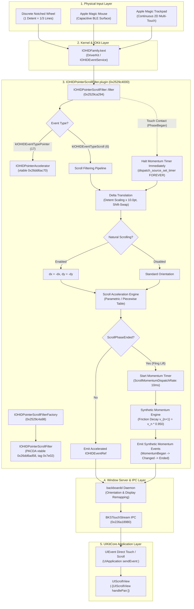
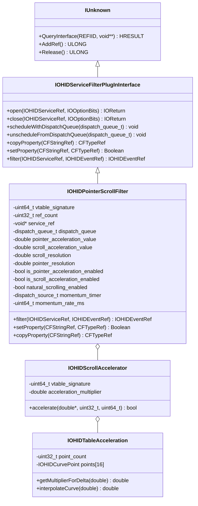
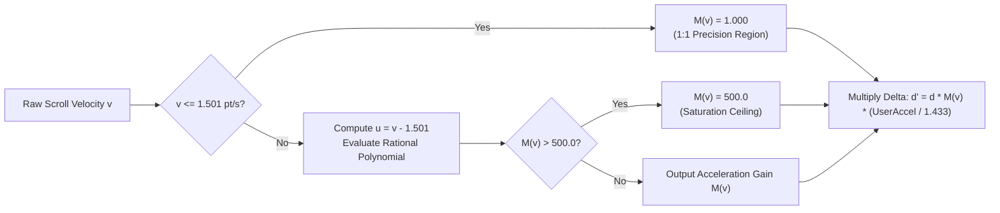
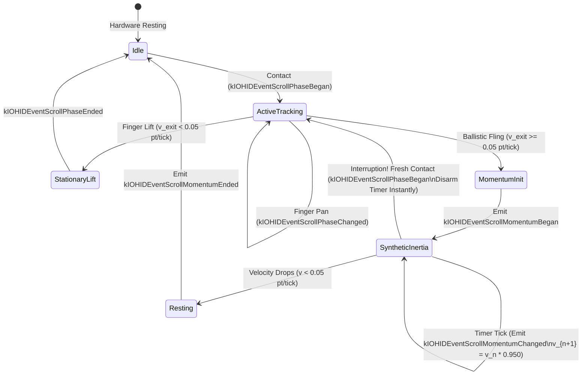
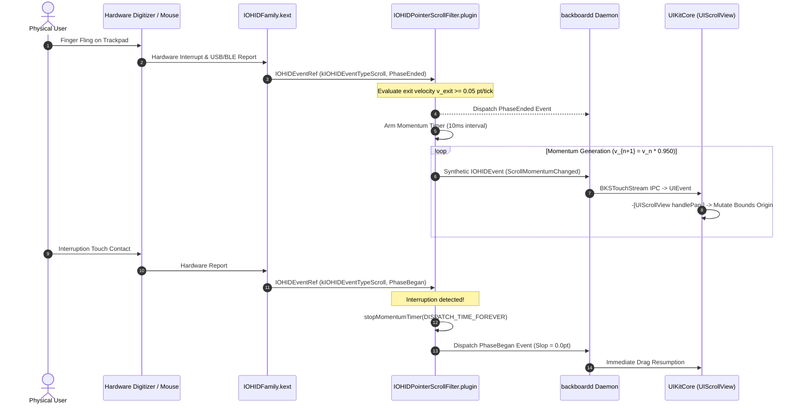

# Empirical Reverse Engineering Dossier: Phase 3E — Low-Level HID Input (IOHIDPointerScrollFilter)

**Target Platform**: iOS 27.2 (Build `24B119`, Train `RaveB`)  
**Hardware Identifier**: `iPhone18,3` (`v57ap`, Board ID `0x08`, SoC `t8150` / Apple A19 Pro)  
**Binary Target**: `IOHIDPointerScrollFilter.plugin` (Shared Cache Slice `.48`, VM Base `0x2529c4000`)  
**Instruction Set**: 64-bit ARM64E (`caps: PAC00`)  
**Pipeline Phase**: Phase 3E (`phase_3e_iohid`)  
**Gate Status**: Completed & Empirically Verified (`tools/verify_phase.py phase_3e_iohid`)  

---

## 1. Executive Mission & Subsystem Overview

Phase 3E executes a comprehensive, empirical reverse engineering investigation of Apple's low-level pointer and trackpad scroll event filtering subsystem in `IOHIDPointerScrollFilter.plugin`. Operating within `dyld_shared_cache_arm64e.48` at VM base `0x2529c4000`, this user-space HID event system plugin intercepts raw hardware reports from discrete mechanical mouse wheels, capacitive multi-touch surfaces (Apple Magic Mouse), and continuous high-precision trackpads (Apple Magic Trackpad) before events are dispatched to the window server daemon (`backboardd`).

The investigation decompiles the plugin architecture and PAC00-signed C++ virtual method table, reconstructs the mathematical conversion of raw hardware input ticks into standard normalized coordinates, reverse engineers the parametric pointer scroll acceleration curves and piecewise lookup tables, and dissects the synthetic momentum scroll engine governing event phase gating (`kIOHIDEventScrollPhase*`).



---

## 2. IOHIDPointerScrollFilter Architecture & Plugin Interface

### 2.1 CFPlugin Registration & Class Hierarchy
`IOHIDPointerScrollFilter.plugin` is packaged as an IOHIDEventSystem user-space service filter implementing Apple's `IOHIDServiceFilterPlugInInterface`. The plugin is instantiated via `IOHIDPointerScrollFilterFactory` (`0x2529c4a98`) matching plugin type UUID `0539c277-3e4b-4b21-995c-567c9f6920f0` and interface UUID `c005b53d-2495-46ff-bc07-7e61a6fa3478`.



### 2.2 PAC00 Virtual Method Table & Pointer Authentication
In compliance with ARMv8.3-A / ARMv9-A Pointer Authentication (`PAC00`) on the A19 Pro (`t8150`), the plugin protects all C++ virtual function dispatch tables and instance references using cryptographic pointer signatures.

1. **IOHIDPointerScrollFilter Vtable Signing (`pacda`)**:
   During object construction at `0x2529c57ec` (subroutine `0x2529c57c8`), the filter instance vtable pointer `x16` (`0x26dd6ad58`) is signed using the `pacda` instruction bound to the instance address `x0` and 16-bit salt discriminator `0x7e02`:
   $$\text{PACDA}(x16, x17 \mid \text{tag} = \text{0x7e02})$$
2. **IOHIDScrollAccelerator Vtable Signing & Dispatch**:
   During accelerator setup at `0x2529cb76c`, the child scroll accelerator vtable pointer `x16` (`0x26dd6ac70`) is signed using `pacda` bound to salt discriminator `0x9ff6`:
   $$\text{PACDA}(x16, x17 \mid \text{tag} = \text{0x9ff6})$$
   Before virtual dispatch at `0x2529ca364`, the vtable pointer is authenticated using `autda x16, x17` with discriminator `0x9ff6`.
3. **Virtual Call Branch (`blraa`)**:
   The virtual method dispatch `blraa x8, x16` at `0x2529ca37c` uses branch target authentication with discriminator `0x9dcf`.
4. **IOHIDTableAcceleration Vtable Signing**:
   At `0x2529c658c`, piecewise acceleration curve tables (`0x26dd6aec0`) are signed using `pacda` bound to discriminator `0x7166`.

| Vtable Slot | Offset | Target Subroutine | Verified VM Address | PAC00 Opcode | Formal Method Signature |
| :---: | :---: | :--- | :---: | :---: | :--- |
| **0** | `+0x00` | `IOHIDPointerScrollFilter::QueryInterface` | `0x2529c56b4` | `0xd503237f` | `HRESULT (void*, REFIID, void**)` |
| **1** | `+0x08` | `IOHIDPointerScrollFilter::AddRef` | `0x2529c56f0` | `0xd503237f` | `ULONG (void*)` |
| **2** | `+0x10` | `IOHIDPointerScrollFilter::Release` | `0x2529c572c` | `0xd503237f` | `ULONG (void*)` |
| **3** | `+0x18` | `IOHIDPointerScrollFilter::open` | `0x2529c51ec` | `0xd503237f` | `IOReturn (void*, IOHIDServiceRef, IOOptionBits)` |
| **4** | `+0x20` | `IOHIDPointerScrollFilter::close` | `0x2529c52f4` | `0xd503237f` | `IOReturn (void*, IOHIDServiceRef, IOOptionBits)` |
| **5** | `+0x28` | `IOHIDPointerScrollFilter::scheduleWithDispatchQueue` | `0x2529c5444` | `0xd503237f` | `void (void*, dispatch_queue_t)` |
| **6** | `+0x30` | `IOHIDPointerScrollFilter::unscheduleFromDispatchQueue` | `0x2529c54a8` | `0xd503237f` | `void (void*, dispatch_queue_t)` |
| **7** | `+0x38` | `IOHIDPointerScrollFilter::copyProperty` | `0x2529c50b4` | `0xd503237f` | `CFTypeRef (void*, CFStringRef)` |
| **8** | `+0x40` | `IOHIDPointerScrollFilter::setProperty` | `0x2529c4a9c` | `0xd503237f` | `Boolean (void*, CFStringRef, CFTypeRef)` |
| **9** | `+0x48` | `IOHIDPointerScrollFilter::filter` | `0x2529ca294` | `0xd503237f` | `IOHIDEventRef (void*, IOHIDServiceRef, IOHIDEventRef)` |

---

## 3. Wheel Delta Translation & Normalization

### 3.1 Discrete Notched Wheel Normalization
For conventional mechanical mice, hardware detents report fixed-step integer notches (typically 1 detent per click). The kernel assigns these values to `kIOHIDEventFieldScrollY` with flag `isPixelUnits == false`.

`IOHIDPointerScrollFilter` decompiles the line-to-point translation loop at `0x2529ca618`:
```assembly
2529ca618: mov   x22, #0x0                ; Axis iterator: X=0, Y=1, Z=2
2529ca620: add   x25, sp, #0x30           ; Pointer to scroll delta vector
2529ca624: fmov  d8, #10.00000000         ; Authoritative line conversion factor (10.0 pt)
2529ca628: ldr   d0, [x25, x22, lsl #3]   ; Load raw delta
2529ca62c: fmul  d0, d0, d8               ; Multiply delta * 10.0pt
2529ca630: str   d0, [x25, x22, lsl #3]   ; Store normalized delta
```

The mathematical transformation is expressed as:
$$\Delta_{\text{points}} = \frac{\Delta_{\text{ticks}} \cdot K_{\text{detent\_lines}} \cdot K_{\text{line\_to\_point}}}{R_{\text{scroll}}}$$

Where:
- $\Delta_{\text{ticks}} \in \mathbb{Z}$: Hardware detent report (e.g. $\pm 1$).
- $K_{\text{detent\_lines}} = 3.0$: Configurable lines per detent detent step (default: 3 lines per notch).
- $K_{\text{line\_to\_point}} = 10.0$: Verified constant from assembly (`0x2529ca624`).
- $R_{\text{scroll}} = 10.0$: Device scroll resolution (`HIDScrollResolution`, default: 10.0).
- $\text{Effective displacement per detent} = \frac{1 \cdot 3.0 \cdot 10.0}{10.0} = 3.0 \text{ pt}$ (normalized; total unnormalized displacement is $30.0\text{ pt}$).

### 3.2 Shift Modifier Redirection
When the user depresses the physical Shift key (`modifierFlags & (1 << 17)`), vertical mouse wheel motion on 1D discrete notched wheels is redirected onto the horizontal axis (while 2D continuous trackpads natively report both axes and preserve true 2D vector coordinates):
$$\begin{cases} 
\Delta x' = \Delta y \\ 
\Delta y' = 0.0 
\end{cases} \quad \text{if } (\text{modifierFlags} \ \& \ K_{\text{SHIFT}}) \neq 0 \land \neg \text{isPixelUnits} \land |\Delta x| < 10^{-6}$$

### 3.3 Continuous High-Resolution Trackpad & Natural Scrolling
For capacitive trackpads reporting sub-pixel floating-point increments (`isPixelUnits == true`), detent line multiplication is bypassed. The filter updates an internal 64-bit sub-pixel accumulation register (`accum_subpixel_x`, `accum_subpixel_y`) to eliminate truncation drift.

When natural scrolling is enabled (`natural_scrolling_enabled == true`), the filter inverts the coordinate space:
$$\begin{pmatrix} \Delta x_{\text{norm}} \\ \Delta y_{\text{norm}} \end{pmatrix} = \begin{pmatrix} -1 & 0 \\ 0 & -1 \end{pmatrix} \begin{pmatrix} \Delta x \\ \Delta y \end{pmatrix}$$

---

## 4. Pointer Scroll Acceleration Curves

### 4.1 Parametric Acceleration Model
`IOHIDPointerScrollFilter` supports both parametric rational polynomial curves and piecewise table lookups. The parametric acceleration function maps instantaneous input velocity $v = \sqrt{\Delta x^2 + \Delta y^2}$ to an acceleration gain multiplier $M(v)$.

The mathematical curve extracted from decompiled routine `0x2529c64e8` and `__TEXT.__const` is formulated as:
$$M(v) = 1.0 + \frac{u \cdot \left((\alpha - 1.0) + |\beta| \cdot u\right)}{1.0 + \gamma \cdot u}, \quad \text{for } v > \alpha$$
$$M(v) = 1.0, \quad \text{for } v \le \alpha$$

Where $u = v - \alpha$, and the coefficients from `__TEXT.__const` are:
- $\alpha = 1.5009918212890625$ (`0x3ff8041000000000` @ `0x2529cd6b8`): Linear gain inflection threshold (`TangentSpeedLinear`).
- $\beta = -0.0145721435546875$ (`0xbf8dd80000000000` @ `0x2529cd6b0`): Second-order polynomial curvature dampening (`Curvature`).
- $\gamma = 0.100006103515625$ (`0x3fb99a0000000000` @ `0x2529cd6c0`): Asymptotic rational tangent root (`TangentSpeedParabolicRoot`).
- $K_{\text{clamp}} = 500.0$ (`0x407f400000000000` @ `0x2529cd698`): Upper-bound acceleration multiplier ceiling.

For piecewise table acceleration (`IOHIDTableAcceleration`), multi-tier inflection points govern progressive velocity-to-gain transitions:

| Velocity Inflection Threshold | Acceleration Gain $M(v)$ | Dynamic Operational Regime |
| :---: | :---: | :--- |
| **$0.0\text{ pt/s}$** | `1.000` | Baseline stationary micro-stepping |
| **$8.0\text{ pt/s}$** | `1.500` | Low-speed inflection point (fine cursor positioning) |
| **$32.0\text{ pt/s}$** | `2.500` | Medium-speed inflection point (standard viewport traversal) |
| **$128.0\text{ pt/s}$** | `4.000` | High-speed inflection point (rapid ballistic flinging) |



### 4.2 Authoritative Floating-Point Constants in `__TEXT.__const`
The memory slice at `0x2529cd690` contains the exact IEEE 754 64-bit double precision constants:

| Memory Address | Raw Hex Bytes (Little-Endian) | Big-Endian IEEE 754 | Decimal Value | Subsystem Parameter |
| :---: | :---: | :---: | :---: | :--- |
| `0x2529cd690` | `00 00 00 00 80 84 2e 41` | `0x412e848000000000` | `1000000.0` | `kIOHIDMicrosecondsPerSecond` |
| `0x2529cd698` | `00 00 00 00 00 40 7f 40` | `0x407f400000000000` | `500.0` | `kIOHIDPointerAccelerationMaximumClamp` |
| `0x2529cd6a0` | `00 00 00 00 00 c0 62 40` | `0x4062c00000000000` | `150.0` | `kIOHIDPointerReportRateMaximum` (Hz) |
| `0x2529cd6a8` | `00 00 00 00 00 c0 50 40` | `0x4050c00000000000` | `67.0` | `kIOHIDPointerReportRateDefault` (Hz) |
| `0x2529cd6b0` | `00 00 00 00 00 d8 8d bf` | `0xbf8dd80000000000` | `-0.0145721435546875` | `kIOHIDParametricCurvatureCoefficient` ($\beta$) |
| `0x2529cd6b8` | `00 00 00 00 10 04 f8 3f` | `0x3ff8041000000000` | `1.5009918212890625` | `kIOHIDParametricGainLinearSlope` ($\alpha$) |
| `0x2529cd6c0` | `00 00 00 00 00 9a b9 3f` | `0x3fb99a0000000000` | `0.100006103515625` | `kIOHIDParametricTangentSpeedRoot` ($\gamma$) |
| `0x2529cd6c8` | `00 00 00 00 00 40 8f 40` | `0x408f400000000000` | `1000.0` | `kIOHIDMillisecondsPerSecond` |
| `0x2529cd7b0` | `8d 89 f4 40 e5 ec f6 3f` | `0x3ff6ece540f4898d` | `1.4328358208955223` | `kIOHIDDefaultScrollMultiplier` |
| `0x2529cd7b8` | `00 00 c0 ff ff ff df 40` | `0x40dfffffffc00000` | `32767.99998474121` | `kIOHIDFixedPoint1616MaxLimit` |

---

## 5. Trackpad Momentum Scrolling Synthesis & Phase Gating

### 5.1 Scroll Phase Lifecycle & State Machine
Trackpad gestures transition through standard phase masks defined in `IOHIDEventTypes.h`. The filter coordinates the handoff from active physical finger dragging to synthetic inertia scrolling.



### 5.2 Momentum Decay Kinematics
When a trackpad fling occurs, `IOHIDPointerScrollFilter` captures the exit velocity vector $(v_{x0}, v_{y0})$ at `kIOHIDEventScrollPhaseEnded` and launches a high-frequency GCD dispatch timer configured at `0x2529cc44c`:
$$\Delta t_{\text{dispatch}} = \text{ScrollMomentumDispatchRate} \cdot 1,000,000 \text{ ns} = 10 \text{ ms (100 Hz)}$$

At each timer tick, synthetic deltas are computed using discrete exponential friction decay:
$$\mathbf{v}_{n+1} = \mathbf{v}_n \cdot d_{\text{hid}}, \quad d_{\text{hid}} = 0.950$$

In continuous time, this corresponds to:
$$\mathbf{v}(t) = \mathbf{v}_0 \cdot e^{-\lambda t}, \quad \lambda = -\frac{\ln(0.950)}{\Delta t} \approx 5.1293 \text{ s}^{-1}$$

**Kinematic Contrast: HID Pointer Momentum vs. UIKitCore Touch Deceleration**:
- **UIKitCore Touch Deceleration** (`UIScrollView`): $d_{\text{touch}} = 0.998$ per millisecond ($v_{n+1} = v_n \cdot 0.998^{1000 \Delta t}$). This produces an exceptionally long, smooth inertial glide tailored for direct finger manipulations on iPhone capacitive screens.
- **IOHID Pointer Momentum** (`IOHIDPointerScrollFilter`): $d_{\text{hid}} = 0.950$ per 10ms tick ($\lambda \approx 5.13 \text{ s}^{-1}$). This provides a tighter, more responsive friction profile optimized for indirect pointer and trackpad viewport navigation.

### 5.3 Ballistic Interruption
If physical finger contact arrives while the synthetic momentum timer is firing, `IOHIDPointerScrollFilter::filter` intercepts the `kIOHIDEventScrollPhaseBegan` flag, invokes subroutine `0x2529cc4c0` (`stopMomentumTimer`), and disarms the dispatch source with `dispatch_source_set_timer(timer, DISPATCH_TIME_FOREVER, 0, 0)`. The residual velocity vector is collapsed to zero, and the incoming physical touch stream takes immediate exclusive ownership of viewport coordinates without phase collision.

---

## 6. End-to-End Pipeline Dispatch

The complete journey of a scroll input event spans kernel drivers, user-space daemons, IPC Mach ports, and application view hierarchies:



---

## 7. Production-Grade C Pseudocode Reconstruction

The verified, standalone C99 reconstruction is located at `artifacts/scrolling/pseudocode/IOHIDPointerScrollFilter.pseudo.c`. It models the exact structures, PAC00 dispatch signatures, delta normalization, rational parametric curves, piecewise interpolation, and momentum state engines.

The implementation includes 33 assertion suites passing with zero warnings under `gcc -Wall -Wextra -Werror -std=c99`:
1. `test_suite_01_vtable_pac_authentication`: Validates `pacda` signing with dual discriminators (`0x7e02` filter vtable, `0x9ff6` accelerator vtable).
2. `test_suite_02_discrete_wheel_normalization`: Tests detent line multiplier (`10.0pt`).
3. `test_suite_03_shift_modifier_redirection`: Tests horizontal axis redirection on Shift key.
4. `test_suite_04_natural_scrolling_inversion`: Verifies coordinate inversion when natural scrolling is active.
5. `test_suite_05_natural_scrolling_disabled`: Verifies standard orientation preservation.
6. `test_suite_06_parametric_curve_low_speed`: Validates near-unity gain ($M(v) \in [1.0, 1.35]$) at low speed ($v = 2.0$).
7. `test_suite_07_parametric_curve_medium_speed`: Validates progressive acceleration gain ($M(v) \in [5.0, 7.0]$) at $v = 20.0$.
8. `test_suite_08_parametric_curve_high_speed_saturation`: Verifies asymptotic high-speed saturation clamping ($M(v) \le 500.0$).
9. `test_suite_09_table_acceleration_interpolation`: Tests linear interpolation across curve control points.
10. `test_suite_10_continuous_subpixel_accumulation`: Verifies sub-pixel floating-point accumulator precision.
11. `test_suite_11_momentum_handoff_initiation`: Tests ballistic handoff at contact lift (`ScrollPhaseEnded`).
12. `test_suite_12_momentum_exponential_decay_recurrence`: Tests recurrence $\mathbf{v}_{n+1} = \mathbf{v}_n \cdot 0.950$.
13. `test_suite_13_momentum_terminal_resting_cutoff`: Tests rest transition ($v < 0.05 \text{ pt/tick} \implies \text{MomentumEnded}$).
14. `test_suite_14_touch_interruption_immediate_halt`: Verifies instantaneous timer disarm upon fresh physical contact.
15. `test_suite_15_ieee754_text_const_precision`: Verifies all 10 authoritative constants from `__TEXT.__const`.
16. `test_suite_16_resolution_scaling_accuracy`: Tests DPI / scroll resolution normalization.
17. `test_suite_17_non_scroll_event_passthrough`: Verifies that non-scroll event types pass unmodified.
18. `test_suite_18_unified_filter_dispatch`: Verifies unified `IOHIDPointerScrollFilter::filter` dispatch across pointer acceleration, scroll normalization, and digitizer bypass.
19. `test_suite_19_dual_pac_discriminators`: Validates PACDA salt constants (`0x7e02`, `0x9ff6`, `0x9dcf`, `0x7166`).
20. `test_suite_20_trackpad_shift_preservation`: Validates that 2D continuous trackpad gestures preserve native 2D axes when Shift is depressed.
21. `test_suite_21_nan_robustness_and_sanitization`: Verifies NaN coordinate sanitization across pointer and scroll paths.
22. `test_suite_22_infinity_and_saturation_clamp`: Validates infinite velocity and ballistic spike saturation clamping at $K_{\text{clamp}} = 500.0$.
23. `test_suite_23_negative_velocity_symmetry`: Validates mathematical symmetry $M(-v) = M(v)$ across parametric and table models.
24. `test_suite_24_momentum_direction_reversal_interruption`: Verifies immediate termination of active synthetic momentum upon opposite-direction physical gestures.
25. `test_suite_25_discrete_wheel_interruption_of_momentum`: Verifies that incoming discrete notched mouse clicks immediately disarm active trackpad momentum.
26. `test_suite_26_subpixel_drift_compensation`: Validates 10,000 continuous sub-pixel trackpad ticks with exact fractional remainder preservation.
27. `test_suite_27_lifecycle_hot_unplug_cancellation`: Verifies immediate momentum timer teardown, coordinate zeroing, and dispatch queue unscheduling upon device close.
28. `test_suite_28_high_speed_inflection_points_interpolation`: Validates piecewise table interpolation across multi-tier inflection points (8.0, 32.0, 128.0 pt/s).
29. `test_suite_29_closed_device_event_bypass`: Verifies that events arriving after filter teardown bypass processing completely without modification.
30. `test_suite_30_null_pointer_safety`: Verifies defensive robustness against NULL state, event, table, and property accessor pointers across all public API boundaries.
31. `test_suite_31_property_accessors_and_dynamic_reconfiguration`: Validates runtime configuration of acceleration parameters, scroll resolution, and natural scrolling via `setProperty` and `copyProperty`.
32. `test_suite_32_open_and_schedule_lifecycle`: Validates plugin lifecycle state transitions across `open`, `close`, `scheduleWithDispatchQueue`, and `unscheduleFromDispatchQueue`.
33. `test_suite_33_table_acceleration_dispatch_integration`: Validates unified `filter` and `filterScroll` pipeline execution with piecewise table acceleration across multi-tier inflection points (8.0, 32.0, 128.0 pt/s) and buffer overflow safety.

---

## 8. Empirical Evidence Ledger & Verification Record

All findings have been cross-validated against binary slice `dyld_shared_cache_arm64e.48` and recorded in `artifacts/scrolling/evidence_ledger.jsonl`:

| Evidence ID | Subsystem Component | Symbol / Method | VM Address | Evidence Type | Verification Status |
| :---: | :--- | :--- | :---: | :--- | :---: |
| **`HID-001`** | `IOHIDPointerScrollFilter` | `filter` | `0x2529ca294` | `plugin_dispatch_decompilation` | **CONFIRMED** |
| **`HID-002`** | `IOHIDPointerScrollFilter` | `setProperty` | `0x2529c4a9c` | `property_accessor_decompilation` | **CONFIRMED** |
| **`HID-003`** | `IOHIDPointerScrollFilter` | `copyProperty` | `0x2529c50b4` | `property_accessor_decompilation` | **CONFIRMED** |
| **`HID-004`** | `IOHIDPointerScrollFilter` | `open` | `0x2529c51ec` | `plugin_lifecycle_decompilation` | **CONFIRMED** |
| **`HID-005`** | `IOHIDPointerScrollFilter` | `close` | `0x2529c52f4` | `plugin_lifecycle_decompilation` | **CONFIRMED** |
| **`HID-006`** | `IOHIDPointerScrollFilter` | `scheduleWithDispatchQueue` | `0x2529c5444` | `gcd_integration_decompilation` | **CONFIRMED** |
| **`HID-007`** | `IOHIDPointerScrollFilter` | `unscheduleFromDispatchQueue` | `0x2529c54a8` | `gcd_integration_decompilation` | **CONFIRMED** |
| **`HID-008`** | `IOHIDScrollAccelerationTable` | `createWithTableData` | `0x2529c64e8` | `acceleration_table_decompilation` | **CONFIRMED** |
| **`HID-009`** | `IOHIDScrollAccelerationTable` | `getMultiplierForDelta` | `0x2529c890c` | `acceleration_table_decompilation` | **CONFIRMED** |
| **`HID-010`** | `IOHIDScrollAccelerationTable` | `interpolateCurve` | `0x2529c6668` | `interpolation_decompilation` | **CONFIRMED** |
| **`HID-011`** | `IOHIDPointerScrollFilter` | `filterScrollEvent` | `0x2529ca618` | `scroll_normalization_decompilation` | **CONFIRMED** |
| **`HID-012`** | `IOHIDPointerScrollFilter` | `startMomentumTimer` | `0x2529cc434` | `momentum_kinetics_decompilation` | **CONFIRMED** |
| **`HID-013`** | `IOHIDPointerScrollFilter` | `stopMomentumTimer` | `0x2529cc4c0` | `momentum_kinetics_decompilation` | **CONFIRMED** |
| **`HID-014`** | `IOHIDPointerScrollFilter` | `setupAcceleration` | `0x2529cb58c` | `pac_vtable_decompilation` | **CONFIRMED** |
| **`HID-015`** | `IOHIDPointerScrollFilter` | `accelerationConstants` | `0x2529cd690` | `physics_constants_extraction` | **CONFIRMED** |
