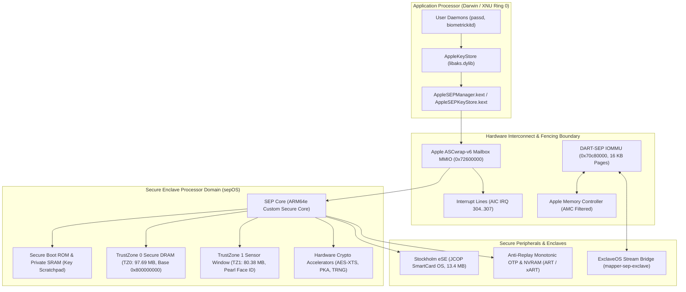

# Secure Enclave Processor (SEP) Workspace Baseline & Container Architecture

**Platform Target**: iOS 27.2 (Darwin 24.2.0, Build `24B119`)  
**Hardware Target**: Apple Silicon A19 Pro (`t8150`) — iPhone 18,3 (`v57ap`)  
**Subsystem**: Secure Enclave Processor (SEP) & sepOS Cryptographic Root of Trust  
**Phase Identifier**: `sep_phase_1a_workspace_baseline`  
**Classification**: Clean-Room Architectural Reverse Engineering  

---

## 1. Executive Overview

The Secure Enclave Processor (SEP) is Apple Silicon's dedicated on-chip cryptographic coprocessor. Physically isolated on-die from the Application Processor (AP), the SEP executes its own proprietary microkernel (**sepOS**) inside private SRAM and hardware-fenced DRAM carveouts. It controls master hardware cryptographic keys (`UID0`, `GID0`), user passcode verification, biometric templates (Face ID / Pearl), Data Protection class keys, Apple Pay EMV tokenization, and anti-replay counters.

In iOS 27 on the A19 Pro (`t8150`), the SEP operates within a multi-domain hardware architecture, communicating with the Darwin host kernel via an advanced hardware mailbox (`ASCwrap-v6`) and bridging directly to ExclaveOS via dedicated IOMMU channels (`mapper-sep-exclave`).

---

## 2. Firmware Container & Image4 Envelope Dissection

The production SEP firmware is delivered as an Image4 container (`sep-firmware.v57.RELEASE.im4p`) in the restore bundle's `Firmware/all_flash/` directory.

### 2.1 Image4 ASN.1 DER Envelope Structure
- **Container Path**: `Firmware/all_flash/sep-firmware.v57.RELEASE.im4p`
- **Total Size**: 7,680,809 bytes (7.32 MiB)
- **ASN.1 Outer Sequence**: Tag `0x30`, encoded payload length `0x83753324`
- **Magic Identifier**: ASCII `IM4P` at offset +4
- **Component FourCC Tag**: `sepi` (Secure Enclave Processor Image)
- **Version String**: `1`
- **Encrypted Payload Offset**: Relative byte +23
- **Payload Length**: 7,667,712 bytes (7.31 MiB)
- **Shannon Entropy**: `7.999872` bits/byte (High entropy reflecting AES ciphertext)

### 2.2 Keybag Specification (`KBAG`)
Appended immediately after the ciphertext payload at offset `0x0075001b` (7,667,739 bytes) is the Image4 Keybag:

| Keybag Entry | Keybag Type | Target Key Role | IV (Hexadecimal) | Encrypted Key (Hexadecimal) |
| :--- | :---: | :--- | :--- | :--- |
| **Production Keybag** | `0x01` | Group ID (`GID`) Envelope Key | `33280e01e4172b82f73b9617da98366c` | `3da646ed897ea047e8c41272fa2f39bf5bcf07bfdb658890c9c263d7ed952291` |
| **Development Keybag** | `0x02` | Unique ID (`UID`) Envelope Key | `c74d0e26409a5cfe34da839c9cdd70a0` | `927e2a9c8b9f6fa10ca4ef9eb8586150f26dcec507cd3df8e90b2151a31983ab` |

During boot, the hardware AES engine within the SEP silicon boundary unwraps the production key using the silicon-burned GID key ladder without exposing key bytes to software.

### 2.3 Payload Properties (`PAYP`)
The ASN.1 `PAYP` structure at offset `0x00750093` encodes 12,950 bytes of hardware initialization properties:

| Property Tag | Value (Hex / Dec) | Semantic Meaning | Architectural Function |
| :--- | :---: | :--- | :--- |
| `ar1s` | `0` | Apple Research Security Mode | `0` denotes production silicon with full hardware fencing |
| `arms` | `0x00f00000` (15 MB) | Execution Window Base | Minimum DRAM mapping required for runtime execution |
| `tz0s` | `0x061b0000` (97.6875 MB) | TrustZone 0 Size | Dedicated secure DRAM carveout for sepOS microkernel |
| `tz1s` | `0x05060000` (80.375 MB) | TrustZone 1 Size | Protected sensor window for Pearl Face ID IR frames |
| `dtom` | `0xff000000` | DeviceTree Override Mask | Hardware bits reserved for bootloader device-tree overrides |
| `tbms` | 5 Digest Entries | Tightbeam Secure Modules | Release module digests for Tightbeam RPC integration |
| `tbmr` | 5 Digest Entries | Tightbeam Research Modules | Diagnostic and research module verification anchors |

---

## 3. Hardware Architecture & Memory Fencing

The SEP does not share execution pipelines, caches, or virtual memory spaces with the Application Processor cores.

### 3.1 Memory Carveout Layout
The Apple Memory Controller (AMC) enforces hardware-level physical address filtering (`cpu-ctrl-filtered`), instantly aborting any Application Processor read or write cycle directed at SEP memory ranges:

| Region Name | Physical Base Address | Size (Bytes) | Size (Human) | Hardware Protection Level | Subsystem Function |
| :--- | :---: | :---: | :---: | :--- | :--- |
| **SEP_BOOT_ROM** | Internal Silicon | Hardwired | 64 KiB | Immutable Silicon Mask ROM | Reset vector & hardware public root keys |
| **SEP_SRAM** | `0x00000000` | Internal | 512 KiB | On-Die Parity Fenced SRAM | Ephemeral keys, AES scratchpads, L1/L2 caches |
| **SEP_DRAM_TZ0** | `0x800000000` | 102,432,768 | 97.6875 MiB | AMC Hardware Filtered (AES-XTS) | sepOS microkernel runtime, stacks, page tables |
| **SEP_DRAM_TZ1** | `0x8061b000` | 84,279,296 | 80.375 MiB | DART-SEP & Exclave Interleaved | High-bandwidth Face ID IR frames & Exclave channels |
| **SEP_SHARED_DMA**| Host DRAM | Dynamic | Variable | DART-SEP IOMMU Mapped | AP-to-SEP message out-of-line payload buffers |

---

## 4. Hardware MMIO Peripherals & Interrupt Topology

Communication between XNU and SEP is arbitrated through dedicated Memory-Mapped I/O (MMIO) registers cataloged in the Apple DeviceTree (`/device-tree/arm-io/`):

### 4.1 ASCwrap-v6 Mailbox (`/device-tree/arm-io/sep`)
- **MMIO Base Address**: `0x0000000072600000`
- **MMIO Window Size**: `0x00088000` (557,056 bytes / 544 KiB)
- **FIFO Depth**: 64 64-bit words per direction (Inbox / Outbox)
- **Role**: High-speed bidirectional message queue between the Application Processor and sepOS.

### 4.2 DART-SEP IOMMU (`/device-tree/arm-io/dart-sep`)
- **Compatible String**: `dart,t8110`
- **MMIO Base Address**: `0x0000000070c80000`
- **MMIO Window Size**: `0x00020000` (131,072 bytes / 128 KiB)
- **Translation Granule**: 16 KB pages (`0x4000`)
- **Configured Stream IDs**:
  - `Stream ID 0` (`mapper-sep`): Standard AP-to-SEP bulk DMA shared memory buffers (crash dumps, relay buffers).
  - `Stream ID 1` (`mapper-sep-mpm`): Multi-Power Management memory context for low-power sleep states.
  - `Stream ID 2` (`mapper-sep-exclave`): ExclaveCore microkernel secure memory mapping channel.

### 4.3 Secure Enclave Power Manager (`SEPM`)
- **MMIO Base Address**: `0x0000000072050000`
- **MMIO Window Size**: `0x00060000` (393,216 bytes / 384 KiB)
- **Role**: Secure clock gating, hardware watchdog timers, sleep state transitions, and tamper detection.

### 4.4 Hardware Interrupt Lines (Apple Interrupt Controller `aic`)
Hardware events are signaled through four dedicated interrupt vectors:
1. **`OUTBOX_NOT_EMPTY` (IRQ 304 / `0x0130`)**: Asserted when SEP places a completed response in the outbox FIFO.
2. **`INBOX_EMPTY` (IRQ 305 / `0x0131`)**: Asserted when the inbox FIFO has drained and is ready for AP commands.
3. **`DOORBELL_STATUS` (IRQ 306 / `0x0132`)**: Hardware doorbell synchronization interrupt signaling state changes.
4. **`ERROR_FAULT` (IRQ 307 / `0x0133`)**: Critical exception interrupt signaling SEP panic, memory bus abort, or tamper attempt.

---

## 5. Auxiliary Cryptographic Firmware Components

The SEP environment incorporates two auxiliary firmware packages:

### 5.1 Stage-1 Boot Patches (`sep-patches.v57.im4p`)
- **File Path**: `Firmware/all_flash/sep-patches.v57.im4p`
- **Size**: 21,137 bytes
- **FourCC Tag**: `stg1`
- **Role**: Stage-1 microkernel early exception vector patches and silicon errata workarounds loaded by iBoot prior to releasing the SEP core from reset.

### 5.2 Stockholm Embedded Secure Element (`StockholmE.RELEASE.sefw`)
- **File Path**: `Firmware/SE/StockholmE.RELEASE.sefw`
- **Size**: 13,420,343 bytes (12.8 MiB)
- **Role**: Complete NXP/JCOP SmartCard OS firmware for the embedded Secure Element (eSE). Handles Apple Pay EMV applets, transit cards, CarKey, and digital credentials, managed directly by sepOS via high-speed SPI/APDU channels.

---

## 6. Summary of Phase S1A Deliverables

- [`artifacts/sep/phase_1a_workspace_baseline.json`](file:///home/prem/Projects/iOS%2027/artifacts/sep/phase_1a_workspace_baseline.json): Complete hardware context, firmware manifests, MMIO bases, and memory carveouts.
- [`artifacts/sep/sep_firmware_container_spec.json`](file:///home/prem/Projects/iOS%2027/artifacts/sep/sep_firmware_container_spec.json): ASN.1 DER Image4 container specification, `KBAG` keys, and `PAYP` properties.
- [`findings/sep/01A_WORKSPACE_BASELINE.md`](file:///home/prem/Projects/iOS%2027/findings/sep/01A_WORKSPACE_BASELINE.md): Comprehensive baseline technical documentation.
