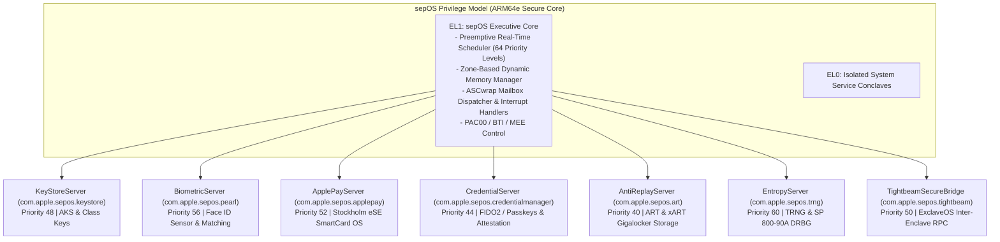

# sepOS Microkernel Architecture & Service Topology

**Target Platform**: iOS 27.2 (Darwin 24.2.0, Build `24B119`)  
**Hardware Target**: Apple Silicon A19 Pro (`t8150`) — iPhone 18,3 (`v57ap`)  
**Subsystem**: Secure Enclave Processor OS (sepOS) Core Architecture  
**Phase Identifier**: `sep_phase_1b_sepos_microkernel`  
**Classification**: Clean-Room Architectural Reverse Engineering  

---

## 1. Executive Summary & sepOS Architectural Paradigm

The Secure Enclave Processor executes **sepOS**, Apple's specialized, capability-grounded microkernel engineered explicitly for the A19 Pro's custom ARM64e secure core. Unlike the hybrid monolithic Darwin kernel that manages user applications, file systems, and network stacks, sepOS is dedicated exclusively to high-assurance security primitives.



### 1.1 Core Microkernel Principles
1. **Zero Ambient Authority**: Individual sepOS tasks have zero default access to memory or peripherals. Each service executes at ARM64 Exception Level 0 (EL0) with dedicated translation tables.
2. **Preemptive Real-Time Scheduling**: The microkernel scheduler operates with 64 priority levels and a 100-microsecond tick. Critical hardware handlers (biometric sensor strobe sync, outbox FIFO drain) execute in hard real-time, preempting soft real-time background tasks.
3. **Hardware Memory Encryption (MEE)**: All DRAM traffic exiting the secure core's on-die cache is encrypted on-the-fly with AES-256-XTS by the Memory Encryption Engine, neutralizing cold-boot attacks and physical DRAM interposers.
4. **Pointer Authentication (PAC00) & BTI**: All sepOS binaries leverage ARMv8.3-A PAC with four dedicated hardware keys (`APIAKey`, `APIBKey`, `APDAKey`, `APDBKey`) re-seeded upon every boot.

---

## 2. Memory Fencing & Carveout Partitioning

The Apple Memory Controller (AMC) isolates SEP physical memory from the Application Processor. The primary carveouts are structured as follows:

```
+----------------------------------------------------------------------------------------------------+
|                                  SEP PHYSICAL MEMORY TOPOLOGY                                      |
+----------------------------------------------------------------------------------------------------+
|  0x00000000        Internal SRAM (512 KiB)       | Secure Boot ROM, L1/L2 Caches, Key Scratchpad   |
+--------------------------------------------------+-------------------------------------------------+
|  0x800000000       TZ0 Primary DRAM (97.69 MiB)  |                                                 |
|    +0x00000000       sep_boot_window (15 MiB)     | Decrypted sepOS Microkernel Text & Vectors      |
|    +0x00f00000       sep_kernel_heap (20 MiB)     | TCBs, Port Descriptors, IPC Message Queues      |
|    +0x02300000       sep_user_task_pools (40 MiB) | EL0 Service Address Spaces                      |
|    +0x04b00000       sep_crypto_staging (22.69 MiB| AES-XTS Key Unwrapping & Class Staging Buffers  |
+--------------------------------------------------+-------------------------------------------------+
|  0x8061b0000       TZ1 Sensor & Bridge (80.38 MiB)|                                                 |
|    +0x00000000       pearl_sensor_frame_buffer (48)| Raw NIR Camera Frames (ISP Direct DMA)         |
|    +0x03000000       ane_feature_buffer (16 MiB)  | Face ID Neural Tensors (ANE Direct DMA)         |
|    +0x04000000       exclave_bridge_window (16.38)| ExclaveOS Direct Memory Channel (DART Stream 2) |
+----------------------------------------------------------------------------------------------------+
```

### 2.1 TrustZone 0 (TZ0) Partitioning
- **Base Physical Address**: `0x800000000`
- **Total Carveout Size**: `102,432,768` bytes (`0x061b0000`, 97.6875 MiB)
- **Sub-Allocations**:
  - **`sep_boot_window` (15 MiB / `0x00f00000`)**: Corresponds directly to the `arms` payload property. Mapped as read-only / executable (`RX`) for microkernel text, exception vectors, and boot data structures.
  - **`sep_kernel_heap` (20 MiB / `0x01400000`)**: Managed by a zone allocator. Allocates 512-byte Thread Control Blocks (TCBs), task descriptors, capability port rights, and circular message ring buffers.
  - **`sep_user_task_pools` (40 MiB / `0x02800000`)**: Provides independent Stage-1 translation table page frames for isolated EL0 services.
  - **`sep_crypto_staging` (22.6875 MiB / `0x016b0000`)**: Scratch memory for bulk key operations, APFS volume key derivations, and encrypted backup bags.

### 2.2 TrustZone 1 (TZ1) High-Bandwidth Sensor Window
- **Base Physical Address**: `0x8061b0000`
- **Total Carveout Size**: `84,279,296` bytes (`0x05060000`, 80.375 MiB)
- **Sub-Allocations**:
  - **`pearl_sensor_frame_buffer` (48 MiB / `0x03000000`)**: Direct-to-DRAM DMA target for the Camera Image Signal Processor (ISP) via `isp_map_iobmd`. Accommodates multi-frame bursts of Near-Infrared (NIR) dot-projector captures without passing through AP memory.
  - **`ane_feature_staging_buffer` (16 MiB / `0x01000000`)**: Shared with the Apple Neural Engine via `ane_map_iobmd` for real-time biometric embedding generation and liveness scoring.
  - **`exclave_secure_bridge_window` (16.375 MiB / `0x01060000`)**: Dedicated memory window arbitrated by DART-SEP Stream ID 2 (`mapper-sep-exclave`), allowing zero-copy sharing between ExclaveOS Conclaves and sepOS.

### 2.3 On-Die Secure SRAM
- **Base Physical Address**: `0x00000000`
- **Size**: 512 KiB (`0x00080000`)
- **Hardware Invariants**:
  - Operates inside the core's isolated voltage domain.
  - Stores the immutable Secure Boot ROM.
  - Holds intermediate cryptographic keys during AES and PKA operations.
  - Hardware-enforced instant zeroization circuitry clears all SRAM lines upon core reset, deep sleep, or tamper detection.

---

## 3. sepOS System Service Topology

The sepOS microkernel hosts seven specialized services executing in isolated address spaces at EL0:

| Service Name | Identifier | Priority | Stack Size | Primary Security Role |
| :--- | :--- | :---: | :---: | :--- |
| **`KeyStoreServer`** | `com.apple.sepos.keystore` | 48 | 64 KiB | AppleKeyStore (AKS), Class A–D key derivation, passcode scrypt backoff |
| **`BiometricServer`** | `com.apple.sepos.pearl` | 56 | 128 KiB | Face ID NIR sensor acquisition, anti-spoofing, signed match tokens |
| **`ApplePayServer`** | `com.apple.sepos.applepay` | 52 | 64 KiB | Stockholm eSE SmartCard OS interaction, EMV cryptogram generation |
| **`CredentialServer`**| `com.apple.sepos.credentialmanager`| 44 | 64 KiB | FIDO2 / WebAuthn passkeys, hardware attestation certificates |
| **`AntiReplayServer`** | `com.apple.sepos.art` | 40 | 32 KiB | Anti-Replay Tokens (`ART`/`xART`), monotonic OTP rollback counters |
| **`EntropyServer`** | `com.apple.sepos.trng` | 60 | 16 KiB | Silicon TRNG entropy collector, NIST SP 800-90A DRBG conditioner |
| **`TightbeamSecureBridge`**| `com.apple.sepos.tightbeam`| 50 | 64 KiB | ExclaveOS inter-enclave RPC bridge (`tbms` module endpoints) |

---

## 4. Mailbox IPC Endpoints & Protocol Multiplexing

All communication between the Darwin host kernel (`AppleSEPManager`) and sepOS is multiplexed across the `ASCwrap-v6` hardware mailbox using 8 dedicated service endpoints:

```
+----------------------------------------------------------------------------------------------------+
|                                    ASCwrap-v6 MAILBOX ENDPOINT MAP                                 |
+----------------------------------------------------------------------------------------------------+
|  Endpoint ID  | Name                         | Target sepOS Service        | Operational Purpose   |
+---------------+------------------------------+-----------------------------+-----------------------+
|  0x01         | SEP_ENDPOINT_CONTROL         | sepOS Executive Core        | Handshake, Sleep/Wake |
|  0x02         | SEP_ENDPOINT_KEYSTORE        | KeyStoreServer              | AKS Keybag Operations |
|  0x03         | SEP_ENDPOINT_BIOMETRIC       | BiometricServer             | Face ID Matching      |
|  0x04         | SEP_ENDPOINT_STORAGE         | AntiReplayServer            | Anti-Replay Tokens    |
|  0x05         | SEP_ENDPOINT_SECURE_ELEMENT  | ApplePayServer              | eSE APDU Passthrough  |
|  0x06         | SEP_ENDPOINT_CREDENTIAL      | CredentialServer            | Passkey Attestation   |
|  0x07         | SEP_ENDPOINT_ENTROPY         | EntropyServer               | Kernel PRNG Reseed    |
|  0x08         | SEP_ENDPOINT_EXCLAVE_BRIDGE  | TightbeamSecureBridge       | Tightbeam RPC (tbms)  |
+----------------------------------------------------------------------------------------------------+
```

### 4.1 Message Framing Protocol
Messages transmitted across the mailbox utilize structured command envelopes:
1. **Header Word**: Encodes message length, endpoint identifier (bits `[11:8]`), sequence tag, and options.
2. **Payload Framing**: For small commands ($\le 32$ bytes), parameters are passed inline within FIFO words.
3. **Out-of-Line (OOL) DMA Buffers**: Large payloads (keybags, certificates, APDUs) are referenced via physical pointers mapped through DART-SEP Stream ID 0 (`mapper-sep`).

---

## 5. Security Mitigations & Fault Isolation

1. **Hardware Memory Isolation**: Even if an attacker achieves Ring 0 / EL1 code execution in Darwin, AMC address filters drop all bus transactions targeting `0x800000000`–`0x80b210000`.
2. **Zero Ambient Authority Ports**: A compromised sepOS service (e.g. `CredentialServer`) cannot read memory belonging to `KeyStoreServer` or forge biometric match tokens.
3. **Silicon Key Ladder Invariance**: The master `UID0` and `GID0` keys are hardwired into silicon logic gates leading directly to the AES engine. No software instruction in sepOS or Darwin can read the raw key bytes.
4. **Hardware Anti-Rollback**: Monotonic One-Time Programmable (OTP) eFuses increment on firmware updates, making it impossible to downgrade sepOS to older builds with known vulnerabilities.

---

## 6. Summary of Phase S1B Deliverables

- [`artifacts/sep/sepos_microkernel_spec.json`](file:///home/prem/Projects/iOS%2027/artifacts/sep/sepos_microkernel_spec.json): Complete microkernel execution model, memory carveouts, and sub-allocations.
- [`artifacts/sep/sepos_service_topology.json`](file:///home/prem/Projects/iOS%2027/artifacts/sep/sepos_service_topology.json): Detailed catalog of the seven sepOS services and eight mailbox IPC endpoints.
- [`findings/sep/01B_SEPOS_MICROKERNEL.md`](file:///home/prem/Projects/iOS%2027/findings/sep/01B_SEPOS_MICROKERNEL.md): In-depth architectural findings documentation.
