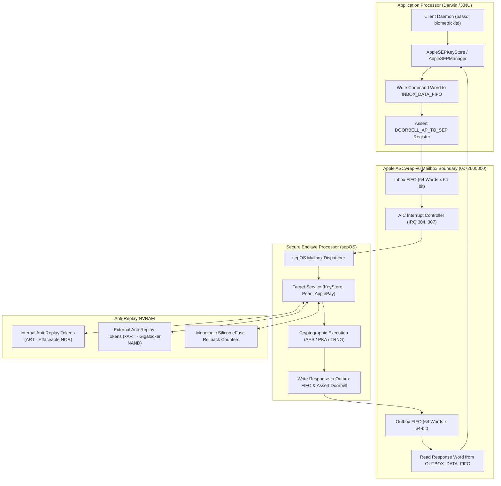

# Secure Enclave Mailbox IPC Protocol, Command Packets & Anti-Replay Storage

**Target Platform**: iOS 27.2 (Darwin 24.2.0, Build `24B119`)  
**Hardware Target**: Apple Silicon A19 Pro (`t8150`) — iPhone 18,3 (`v57ap`)  
**Subsystem**: Apple ASCwrap-v6 Mailbox & Anti-Replay NVRAM Storage (ART/xART)  
**Phase Identifier**: `sep_phase_3_mailbox_protocol`  
**Classification**: Clean-Room Architectural Reverse Engineering  

---

## 1. Executive Summary

The **Apple ASCwrap-v6 Mailbox** is the high-bandwidth, low-latency hardware interface connecting the Application Processor (Darwin XNU Ring 0) to the Secure Enclave Processor (sepOS). Because the SEP executes in a physically isolated memory carveout (`TZ0`), software on the AP cannot execute remote procedure calls or access SEP memory directly. Instead, all interactions occur via bidirectional Memory-Mapped I/O (MMIO) FIFO queues and hardware interrupt doorbells.

Additionally, to prevent physical replay attacks (such as restoring an older flash dump containing outdated passcodes or revoked keys), the SEP integrates **Anti-Replay Storage (ART / xART Gigalocker)**, combining on-chip monotonic OTP eFuses with cryptographically authenticated persistent journal stores.



---

## 2. Hardware Mailbox MMIO Layout (`ASCwrap-v6`)

The mailbox registers are mapped at physical base address `0x0000000072600000` with an address space of `0x00088000` (544 KiB):

| Register Name | Byte Offset | Width | Access Type | Hardware Role |
| :--- | :---: | :---: | :---: | :--- |
| **`INBOX_DATA_FIFO`** | `0x0000` | 64-bit | Write-Only | AP writes 64-bit command message words to SEP queue |
| **`INBOX_STATUS`** | `0x0008` | 32-bit | Read-Only | Tracks available space, empty status, and full status |
| **`DOORBELL_AP_TO_SEP`**| `0x0040` | 32-bit | Write-Only | Asserts hardware doorbell interrupt to the SEP core |
| **`OUTBOX_DATA_FIFO`**| `0x0100` | 64-bit | Read-Only | AP reads 64-bit response message words from SEP queue |
| **`OUTBOX_STATUS`** | `0x0108` | 32-bit | Read-Only | Tracks available response words, empty and full status |
| **`DOORBELL_SEP_TO_AP`**| `0x0140` | 32-bit | Read/Clear | Asserted by SEP upon response completion; cleared by AP |
| **`INTERRUPT_ENABLE`** | `0x0200` | 32-bit | Read/Write | Configures interrupt masks for AIC interrupt delivery |

### 2.1 FIFO Register Bitfields
- **`INBOX_STATUS` (`0x0008`)**:
  - Bits `[7:0]`: Free word count (0 to 64 words).
  - Bit `16`: `INBOX_FULL` flag (1 = queue cannot accept writes).
  - Bit `17`: `INBOX_EMPTY` flag (1 = queue is completely drained).
- **`OUTBOX_STATUS` (`0x0108`)**:
  - Bits `[7:0]`: Available readable word count.
  - Bit `16`: `OUTBOX_FULL` flag.
  - Bit `17`: `OUTBOX_EMPTY` flag (1 = zero messages pending).

---

## 3. Hardware Interrupt Vectors (Apple Interrupt Controller `aic`)

Mailbox activity triggers four dedicated interrupt vectors in the Darwin kernel:

| IRQ Number | Hex Identifier | Interrupt Vector Name | Architectural Trigger Condition |
| :---: | :---: | :--- | :--- |
| **304** | `0x0130` | `SEP_IRQ_OUTBOX_NOT_EMPTY` | Outbox contains at least one response word. Triggers AP read loop. |
| **305** | `0x0131` | `SEP_IRQ_INBOX_EMPTY` | Inbox FIFO has drained completely. Unblocks waiting AP threads. |
| **306** | `0x0132` | `SEP_IRQ_DOORBELL_STATUS` | Doorbell status change signaling asynchronous event or state completion. |
| **307** | `0x0133` | `SEP_IRQ_ERROR_FAULT` | Critical error condition: SEP panic, bus timeout, or physical tamper attempt. |

---

## 4. Message Framing & Command Protocol

Communication packets across the ASCwrap mailbox are framed into structured 64-bit words:

### 4.1 Word 0: Primary Message Header
The first 64-bit word of every message packet encodes transaction metadata:

```
 63       48 47         32 31         16 15        8 7         0
+-----------+-------------+-------------+-----------+-----------+
|   FLAGS   |   OPCODE    |  SEQ_TAG    |  EP_ID    |  LENGTH   |
+-----------+-------------+-------------+-----------+-----------+
```

- **`LENGTH` (Bits `[7:0]`)**: Total message size in 64-bit words (1 to 64 words).
- **`EP_ID` (Bits `[15:8]`)**: Target service endpoint identifier (`0x01` through `0x08`).
- **`SEQ_TAG` (Bits `[31:16]`)**: Unique correlation token matching asynchronous responses to requests.
- **`OPCODE` (Bits `[47:32]`)**: Service-specific command opcode.
- **`FLAGS` (Bits `[63:48]`)**: Control bits:
  - Bit `48`: `MSG_FLAG_OOL` (Payload references Out-Of-Line DMA memory).
  - Bit `49`: `MSG_FLAG_REPLY_EXPECTED` (Synchronous RPC requiring response).
  - Bit `50`: `MSG_FLAG_HIGH_PRIORITY` (Preempts non-urgent background queues).

### 4.2 Standard Core Command Opcodes
1. **AppleKeyStore (`EP 0x02`)**:
   - `0x0201` (`cmsgLOAD_KEYBAG`): Imports system or user keybag.
   - `0x0202` (`cmsgSAVE_KEYBAG`): Exports wrapped keybag.
   - `0x0203` (`cmsgUNWRAP_KEY`): Unwraps per-file media key using specified protection class.
   - `0x0204` (`cmsgWRAP_KEY`): Wraps new file key under target class.
   - `0x0205` (`cmsgDROP_CLASS_KEYS`): Drops Class A keys immediately upon lock event (`secret_drop`).
   - `0x0206` (`cmsgVERIFY_PASSCODE`): Verifies user passcode against hardware scrypt key.
2. **Entropy Collector (`EP 0x07`)**:
   - `0x0701` (`cmsgGET_ENTROPY_FOR_XNU_PRNG`): Transfers 64 bytes of high-entropy TRNG bytes to XNU kernel.
3. **Storage & Anti-Replay (`EP 0x04`)**:
   - `0x0401` (`cmsgART_LOAD_TOKENS`): Validates and loads Anti-Replay Tokens during boot.
   - `0x0402` (`cmsgART_COMMIT_TOKENS`): Persists updated anti-replay state to NVRAM.

---

## 5. Anti-Replay NVRAM Storage Architecture (ART / xART)

To guarantee that an attacker cannot revert passcode backoff timers or restore revoked keys by flashing older raw NAND snapshots, sepOS deploys a two-tiered anti-replay system:

### 5.1 Internal Anti-Replay Tokens (ART)
- **Storage Location**: Dedicated high-endurance NOR flash within the SEP power island (**Effaceable Storage**).
- **Mechanism**: Stores an epoch generation counter and a SHA-384 state hash signed with a message authentication code (`HMAC-SHA256`) using the silicon `UID0` key.
- **Boot Verification**: During `AppleSEPARTStorage::start`, sepOS re-computes the HMAC using the physical silicon UID. If the state does not match the hardware epoch, the boot sequence aborts immediately with a panic.

### 5.2 External Anti-Replay Tokens (xART / Gigalocker)
- **Storage Location**: Dedicated 16 MB encrypted partition in primary NAND flash managed by the `AppleSEPXART` driver.
- **Encryption**: AES-256-XTS with ephemeral session keys negotiated at boot time.
- **Journal Synchronization**: State updates (passcode changes, enrolled biometrics, passkeys) are committed through structured transactions (`cmsgXART_SYNC_GIGALOCKER`).

### 5.3 Monotonic Silicon OTP Rollback Counters
- On-die eFuse arrays contain 32 distinct 64-bit monotonic counters.
- When an iOS update incorporates critical security patches, sepOS burns the corresponding bit permanently in silicon eFuses. Subsequent boot attempts with older sepOS builds are immediately halted by the Secure Boot ROM.

---

## 6. Summary of Phase S3 Deliverables

- [`artifacts/sep/sep_mailbox_protocol.json`](file:///home/prem/Projects/iOS%2027/artifacts/sep/sep_mailbox_protocol.json): Register offsets, FIFO bitfields, interrupt lines, and command framing.
- [`artifacts/sep/anti_replay_nvram_spec.json`](file:///home/prem/Projects/iOS%2027/artifacts/sep/anti_replay_nvram_spec.json): Anti-Replay Tokens (ART), xART Gigalocker, and monotonic OTP counters.
- [`findings/sep/03_MAILBOX_AND_ANTI_REPLAY.md`](file:///home/prem/Projects/iOS%2027/findings/sep/03_MAILBOX_AND_ANTI_REPLAY.md): Comprehensive findings documentation.
