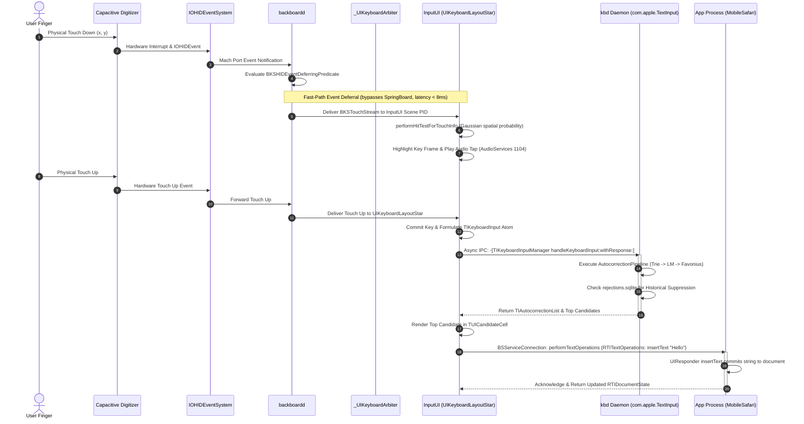
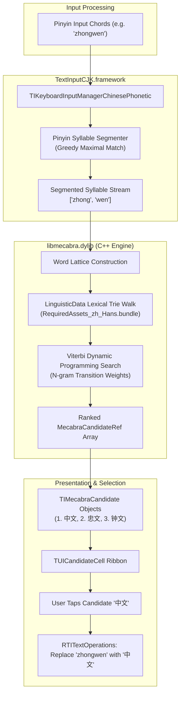

# 06. Architectural Dependency Graph & Subsystem Topology

- **Target Build**: iOS 27.2 (Build `24B119`)
- **Hardware Platform**: `iPhone18,3` (Apple Silicon `t8150`)
- **Architecture**: `arm64e` (Pointer Authentication: `PAC00`, Page Size: 16 KB)
- **Specification Language**: Valid Mermaid (Diagrams 1, 2, 3, 4)

---

## 1. Master Subsystem Dependency Graph

The following Mermaid graph maps all 57 discovered components across the 5 core architectural tiers, detailing inbound and outbound bindings, Mach services, and shared cache linkages:

```mermaid
graph TD
    subgraph Hardware_And_Kernel ["Tier 0: Hardware & Kernel Services"]
        DIGITIZER["Capacitive Touch Digitizer"]
        IOHID["IOHIDEventSystem (Kernel)"]
        AMFI["AppleMobileFileIntegrity.kext"]
        ANE_HW["Apple Neural Engine (ANE HW)"]
    end

    subgraph Userland_Daemons ["Tier 1: Core Userland Daemons & Arbiters"]
        BACKBOARDD["backboardd (Touch Routing)"]
        BKSHID["BKSHIDEventDeferring"]
        ARBITER["KeyboardArbiter.framework (_UIKeyboardArbiter)"]
        KBD_DAEMON["kbd (/System/Library/TextInput/kbd)"]
        STICKERSD["stickersd (Stickers Daemon)"]
        KSERVICES["KeyboardServices.framework (_KSTextReplacementServer)"]
    end

    subgraph Client_App_Process ["Tier 2: Application Process (e.g. MobileSafari, MobileSMS)"]
        APP_RESPONDER["UIResponder / UITextInput"]
        UIKIT_CLIENT["UIKitCore (App In-Process Stub)"]
        RTI_CLIENT["RemoteTextInput (RTIInputSystemClient)"]
    end

    subgraph Keyboard_Host_Process ["Tier 3: Keyboard Host Scene (InputUI Scene - Level 100.0)"]
        INPUT_UI["InputUI Application Scene"]
        RTI_SERVICE["RemoteTextInput (RTIInputSystemService)"]
        UI_IMPL["UIKitCore (UIKeyboardImpl)"]
        UI_LAYOUT["UIKitCore (UIKeyboardLayoutStar)"]
        TUI_FRAMEWORK["TextInputUI.framework"]
        CAND_CELL["TUICandidateCell & Predictive Cards"]
        METAL_PATH["Metal continuous-path (PathPipeline)"]
    end

    subgraph Predictive_Language_Engine ["Tier 4: Predictive & Linguistic Subsystems"]
        TI_CORE["TextInputCore.framework"]
        FAVONIUS["FavoniusCandQualityFilter"]
        TI_CJK["TextInputCJK.framework"]
        TI_SWIFT["TextInputSwift.framework (Apple Intelligence Bridge)"]
        MECABRA["/usr/lib/libmecabra.dylib (C++ Engine)"]
        CORE_EMOJI["CoreEmoji & EmojiFoundation"]
    end

    subgraph Asset_And_Storage_Layer ["Tier 5: Assets, Lexicons & Persistent Stores"]
        LAYOUT_BUNDLES["98 TextInput_*.bundle Layout Plists"]
        LINGUISTIC_DATA["/System/Library/LinguisticData (sys.dic, lm.dat, fst.dat)"]
        ARTWORK_CAR["UIKitCore Artwork Assets.car (1,058 renditions)"]
        TUI_CAR["TextInputUI Assets.car (300 renditions)"]
        REJECTIONS_DB["~/Library/Keyboard/rejections.sqlite"]
        SHAPES_DB["~/Library/Keyboard/shape_store.sqlite"]
    end

    %% Event Connections
    DIGITIZER -->|Capacitive Touch Scan| IOHID
    IOHID -->|Mach Port Dispatch| BACKBOARDD
    BACKBOARDD -->|Direct Fast-Path Deferral| BKSHID
    BKSHID -->|BKSTouchStream < 8ms| UI_LAYOUT

    %% App to Arbiter
    APP_RESPONDER -->|Become First Responder| UIKIT_CLIENT
    UIKIT_CLIENT -->|Register Session| RTI_CLIENT
    RTI_CLIENT -->|MachService: com.apple.KeyboardArbiter| ARBITER
    ARBITER -->|Focus Client Token & Level 100.0| INPUT_UI

    %% RTI Client to Service
    RTI_CLIENT <-->|BSServiceConnection / RTIInputSystemSessionProtocol| RTI_SERVICE
    RTI_SERVICE -->|Update TIDocumentState| UI_IMPL
    UI_IMPL -->|Layout Command| UI_LAYOUT
    UI_LAYOUT -->|Render UIKBTree| TUI_FRAMEWORK
    TUI_FRAMEWORK -->|Display Candidates| CAND_CELL
    UI_LAYOUT -->|Particle Ribbon| METAL_PATH

    %% Keyboard Host to Engine
    UI_IMPL -->|MachService: com.apple.TextInput| KBD_DAEMON
    KBD_DAEMON -->|In-Process Linkage| TI_CORE
    TI_CORE -->|Candidate Filtering| FAVONIUS
    TI_CORE -->|Chinese/Japanese Input| TI_CJK
    TI_CORE -->|Writing Tools & Smart Reply| TI_SWIFT
    TI_SWIFT -->|Neural Model Execution| ANE_HW
    TI_CJK -->|Phonetic Conversion| MECABRA
    TI_CORE -->|Emoji Query| CORE_EMOJI
    STICKERSD -->|Sticker Query| TUI_FRAMEWORK

    %% Data Bindings
    UI_LAYOUT -.->|Load Key Geometry| LAYOUT_BUNDLES
    UI_LAYOUT -.->|Extract Glyphs| ARTWORK_CAR
    CAND_CELL -.->|Extract Icons| TUI_CAR
    TI_CORE -.->|Prefix Tries & N-Grams| LINGUISTIC_DATA
    MECABRA -.->|CJK Character Dictionaries| LINGUISTIC_DATA
    FAVONIUS <-->|Read / Write User Rejections| REJECTIONS_DB
    UI_LAYOUT <-->|Read / Write Glide Shapes| SHAPES_DB
    KBD_DAEMON <-->|Text Replacements| KSERVICES
```

---

## 2. Touch Dispatch & Low-Latency Event Flow

The following sequence diagram details the end-to-end event loop from digitizer contact to text assertion in the consumer application:

---

## 3. RemoteTextInput (RTI Oneness) Cross-Process Architecture

The following diagram maps the bidirectional interface contracts synchronizing application text view context with the out-of-process keyboard:

```mermaid
flowchart LR
    subgraph Client_App ["Client Application (MobileSafari)"]
        APP_VIEW["UITextView / UITextField"]
        CLIENT_IMPL["RTIInputSystemClient"]
        DOC_STATE["RTIDocumentState\n- contextBeforeInput\n- selectedText\n- contextAfterInput\n- markedText"]
    end

    subgraph IPC_Transport ["Mach / BSService Boundary"]
        BS_CONN["BSServiceConnection\n(com.apple.RemoteTextInput)"]
        XPC_CHANNEL["NSXPCConnection\n(RTIInputSystemSessionProtocol)"]
    end

    subgraph Server_InputUI ["Keyboard Host (InputUI Scene)"]
        SERVER_IMPL["RTIInputSystemService"]
        SERVER_SESSION["RTIInputSystemServiceSession"]
        UI_HOST["UIKeyboardImpl"]
    end

    APP_VIEW -->|1. Did Begin Editing| CLIENT_IMPL
    CLIENT_IMPL -->|2. Serialize Traits & State| DOC_STATE
    DOC_STATE -->|3. Establish Session| BS_CONN
    BS_CONN -->|4. Forward Session Payload| XPC_CHANNEL
    XPC_CHANNEL -->|5. Instantiate Session Proxy| SERVER_IMPL
    SERVER_IMPL -->|6. Bind Active Session| SERVER_SESSION
    SERVER_SESSION -->|7. Update Keyboard Model| UI_HOST
    UI_HOST -->|8. Generate Text Operations| SERVER_SESSION
    SERVER_SESSION -->|9. Dispatch RTITextOperations| XPC_CHANNEL
    XPC_CHANNEL -->|10. Execute Text Insertion| CLIENT_IMPL
    CLIENT_IMPL -->|11. Mutate Document| APP_VIEW
```

---

## 4. Multilingual & CJK Phonetic Resolution Architecture

The following diagram traces CJK phonetic text processing from Latin input chords to ideographic candidate commits:

